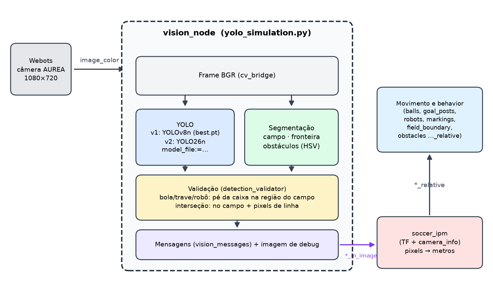
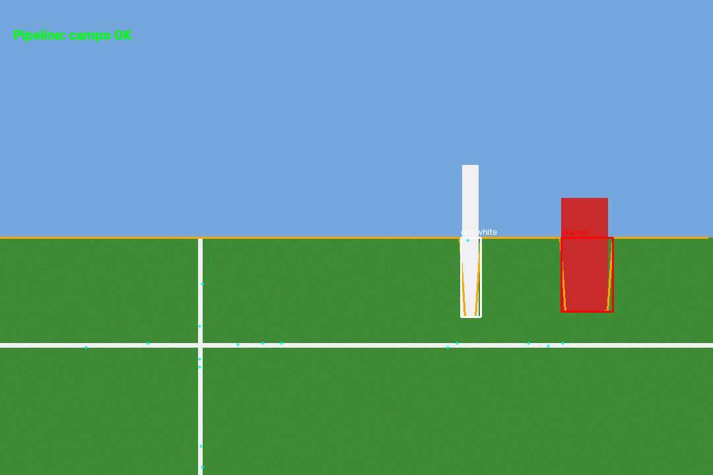
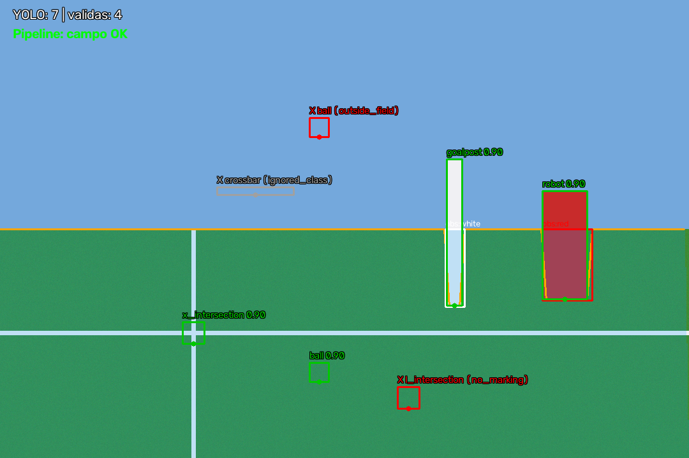

<p align="center">
  <b>Selecionar Idioma / Select Language</b><br>
  <a href="#-português">🇧🇷 Português</a> • <a href="#-english">🇺🇸 English</a>
</p>

---

<a id="-português"></a>
# **🇧🇷 Visão para RoboCup Humanoid: detecção por YOLO validada por segmentação de campo em HSV e ROS 2.**

> A documentação detalhada em [`docs/`](docs/). / *The detailed documentation under `docs/`.*

## Sumário

[Visão geral](#visão-geral) · [Status](#status-do-projeto) · [Resultados](#resultados-em-destaque) · [Evidências visuais](#evidências-visuais) ·
[Estrutura](#estrutura-do-repositório) · [Instalação](#instalação) · [Uso](#uso) · [Pesos](#pesos-do-detector) ·
[Avaliação](#avaliação-e-reprodutibilidade) · [Testes](#testes) · [Projetos relacionados](#projetos-relacionados) ·
[Licença](#licença-e-proveniência) · [Como citar](#como-citar) · [Limitações](#limitações-conhecidas)

## Visão geral

Cada frame da câmera segue dois caminhos independentes: um **detector YOLO** (classes: bola, trave, robô,
interseções L/T/X e travessão) e uma **segmentação por cor** que reconhece o campo, os obstáculos e as linhas.
O cruzamento dos dois é a ideia central: **uma detecção só vale se estiver dentro da área segmentada**. As
detecções aceitas viram mensagens ROS 2 que o [`soccer_ipm`](https://github.com/ros-sports/soccer_ipm) converte de
pixels em metros para o movimento e o behavior.

O projeto separa deliberadamente três coisas:

1. **O algoritmo** (`src/pipeline/`): segmentação HSV utilizável sem ROS e sem detector.
2. **A integração ROS 2** (`src/Webots_YOLOv8/`): YOLO, validação, parâmetros e mensagens.
3. **Os pesos** (`modelo/`): ficam **fora** do código-fonte (veja [Pesos do detector](#pesos-do-detector)).

Os procedimentos de benchmark e de treino também fazem parte do repositório, para que terceiros reproduzam as
medições e avaliem outras arquiteturas. Detalhes em [`docs/architecture.md`](docs/architecture.md).

## Status do projeto

| Item | Estado |
|---|---|
| Integração ROS 2 (nó, launch, mensagens) | **Testada**: build com `colcon` e 46 testes passando com `rclpy` e `soccer_ipm` **reais** |
| Segmentação independente (`python -m pipeline`) | **Testada**, inclusive com um teste que garante a independência de ROS e do detector |
| Comparação de velocidade YOLOv8n × YOLO26n | **Documentada** em [`docs/benchmarks.md`](docs/benchmarks.md) (1 vCPU, imagens sintéticas) |
| Equivalência de **acurácia** YOLOv8n × YOLO26n | **Não estabelecida.** Falta treinar o YOLO26n no mesmo dataset e avaliar a 320 px |
| Pesos treinados | **Não distribuídos** (veja [Pesos do detector](#pesos-do-detector)) |
| Execução no Webots / no robô real | **Não realizada** nesta validação |
| Licença | `LICENSE` (MIT) mantida; **revisão pendente** (veja [Licença e proveniência](#licença-e-proveniência)) |

## Resultados em destaque

Comparação de **velocidade e custo** entre o detector atual (YOLOv8n) e o YOLO26n, nas mesmas condições do nó
(320 px, confiança 0,45):

| Métrica | YOLOv8n | YOLO26n |
|---|---|---|
| Parâmetros | 3,01 milhões | 2,38 milhões |
| GFLOPs a 320 px | 2,02 | 1,31 |
| Latência média de inferência em PyTorch | 17,9 ms | 16,1 ms |
| Latência média de inferência em ONNX Runtime | 17,2 ms | 13,0 ms |
| Tempo total do pipeline por frame | 22,2 ms | 20,4 ms |
| Taxa aproximada do pipeline completo | 45 FPS | 49 FPS |

Média de 3 execuções independentes, **CPU de 1 núcleo**, 1 thread, cenas sintéticas 1080×720, sem a imagem de
debug. Os milissegundos absolutos não se transferem para outro computador; vale a comparação relativa. O pipeline
completo soma conversão da imagem, YOLO, segmentação (≈2,5 ms), validação (≈1,5 ms) e montagem das mensagens.

> **Isto não é uma comparação de acurácia.** O YOLO26n medido usa a arquitetura de 7 classes **sem pesos
> treinados** (a latência independe dos pesos). Metodologia, hardware, configurações e limitações em
> [`docs/benchmarks.md`](docs/benchmarks.md).

## Evidências visuais

**Captura real do Webots (robô AUREA).** Detecções do YOLO (traves e interseções L/T/X) sobre a câmera do simulador.
É do [projeto de simulação](https://github.com/ivan-josef/Webots_YOLOv8) e mostra a versão **anterior** (só YOLO,
**sem** a validação por segmentação):




**Segmentação do campo.** Fronteira do campo (laranja), obstáculos classificados por cor e pontos sobre as linhas
(ciano), gerados por `python -m pipeline`:



**Validação das detecções.** Área azul clara: região em que as detecções valem. Verde: aceitas. Vermelho:
rejeitadas, com o motivo (`outside_field`: bola no céu; `no_marking`: interseção L sobre grama). Cinza: classe
ignorada (travessão):



> **Atenção:** as imagens de segmentação e de validação foram geradas de uma **cena sintética** (por isso o sufixo
> `_synthetic`). Falta uma captura real do Webots **com a validação ativa** (detecções aceitas e rejeitadas); veja
> [`docs/development.md`](docs/development.md#capturas-reais-do-webots-para-o-readme).

## Estrutura do repositório

```
robocup-vision-pipeline/
├── README.md  LICENSE  CITATION.cff  .gitignore  requirements.txt
├── package.xml  setup.py  setup.cfg  resource/        # pacote ROS 2 (ament_python): Webots_YOLOv8
├── config/vision_params.yaml                          # parâmetros do nó
├── launch/vision.launch.py                            # nó de visão + soccer_ipm
├── modelo/                                            # ONDE colocar os pesos (vazia; veja "Pesos")
├── recursos/                                          # calibração do verde do campo (+ README)
├── src/
│   ├── pipeline/                                      # ALGORITMO: segmentação HSV, sem ROS
│   │   ├── color_common.py  field_boundary_detector.py  obstacle_detector.py
│   │   ├── line_detector.py  main_pipeline.py  __main__.py   # python -m pipeline
│   └── Webots_YOLOv8/                                 # INTEGRAÇÃO ROS 2 e detector
│       ├── detections.py  detection_validator.py  vision_parameters.py
│       ├── vision_debug.py  vision_messages.py  running_inference.py  yolo_simulation.py
│       └── tools/  compare_models.py  train_yolo26n.py          # benchmark e treino
├── test/                                              # 58 testes (veja "Testes")
└── docs/  architecture.md  benchmarks.md  development.md  img/  patches/
```

`pipeline` e `Webots_YOLOv8` são pacotes **irmãos** em `src/`. Esse layout (`src/`) é o que mantém o
`colcon build --symlink-install` funcionando também com o setuptools antigo do Humble; veja
[`docs/development.md`](docs/development.md#build). O pacote ROS 2 se chama `Webots_YOLOv8` (nome mantido dos
comandos `ros2 launch`/`ros2 run`).

## Instalação

### Ambientes de referência

| Ambiente | Estado |
|---|---|
| Python **3.10** com as versões do Ubuntu 22.04 (numpy 1.21.5, pandas 1.3.5, OpenCV 4.5.5, pytest 6.2.5) | **Verificado** (parte sem ROS) |
| Python **3.12** + PyTorch 2.14.1 (CPU) + Ultralytics 8.4.184 + ONNX Runtime 1.31.0 | **Verificado** (detector, ferramentas, benchmarks) |
| **ROS 2 Humble** (RoboStack/conda-forge), Python 3.14 | **Verificado**: `colcon build` normal e `--symlink-install`; suíte com `rclpy` e `soccer_ipm` reais |
| **Ubuntu 22.04 + ROS 2 Humble (apt) + Webots**, Python 3.10 (o ambiente-alvo) | **Não testado de ponta a ponta.** Esperado funcionar; o código foi conferido no Python 3.10 com as versões numéricas do apt |

Os comandos de `apt`/`rosdep` abaixo **não foram executados** por quem escreveu este README. Detalhes em
[`docs/development.md`](docs/development.md#ambientes-de-referência).

### 1. Só a segmentação (sem ROS, sem detector)

```bash
git clone https://github.com/diegodemiranda/robocup-vision-pipeline.git
cd robocup-vision-pipeline
python3 -m venv .venv && source .venv/bin/activate
pip install -r requirements.txt
export PYTHONPATH=$PWD/src
python -m pipeline minha_foto.png          # grava minha_foto_segmentada.png
```

### 2. Detector e ferramentas de avaliação (opcional)

```bash
pip install ultralytics onnx onnxruntime    # instala o PyTorch; verificado com ultralytics 8.4.184
```

### 3. Integração ROS 2

```bash
source /opt/ros/humble/setup.bash
mkdir -p ~/ws/src && cd ~/ws/src
git clone https://github.com/diegodemiranda/robocup-vision-pipeline.git
git clone -b humble https://github.com/ros-sports/soccer_interfaces.git
git clone -b humble https://github.com/ros-sports/ipm.git
git clone -b humble https://github.com/ros-sports/soccer_ipm.git
git -C soccer_ipm apply ../robocup-vision-pipeline/docs/patches/soccer_ipm_camera_info.patch   # veja abaixo

cd ~/ws
rosdep install --from-paths src --ignore-src -r -y
pip install ultralytics                     # detector
colcon build --packages-select Webots_YOLOv8      # também funciona com --symlink-install
source install/setup.bash
```

**O patch do `soccer_ipm` corrige um bug real**: se uma trave, um robô ou um obstáculo chega antes do primeiro
`camera_info`, o `soccer_ipm` (branches `humble` e `rolling` do upstream) cai com `AttributeError`. Explicação em
[`docs/development.md`](docs/development.md#dependências-ros-2-e-o-patch-do-soccer_ipm).

O mundo Webots e o robô **AUREA**, que publicam a câmera em `/AUREA/camera_optical_frame/image_color`, **não fazem
parte** deste repositório: estão no projeto de simulação (veja [Projetos relacionados](#projetos-relacionados)).

## Uso

### Segmentação em imagens, vídeos ou câmera (sem ROS)

```bash
python -m pipeline foto.png                          # imagem  -> foto_segmentada.png
python -m pipeline partida.mp4 -o saida.mp4          # vídeo   -> vídeo anotado
python -m pipeline 0 --show                          # câmera 0 ao vivo (q para sair)
python -m pipeline foto.png --hsv-csv meu_hsv.csv    # com as suas faixas HSV
python -m pipeline --help
```

Imagem e vídeo foram testados; `--show` e a leitura de câmera exigem display e dispositivo e **não foram
testados** neste ambiente.

Sem `--hsv-csv`, usa faixas de **exemplo** que precisam ser calibradas para a sua câmera e iluminação. Formato do CSV
(OpenCV: H 0–179, S e V 0–255; o vermelho pode ter `h_min > h_max`, pois o matiz é circular):

```csv
classe,h_min,h_max,s_min,s_max,v_min,v_max
field,35,85,50,255,30,255
marking,0,179,0,60,180,255
red,170,10,100,255,80,255
blue,100,130,100,255,80,255
white,0,179,0,60,180,255
```

Como biblioteca:

```python
import cv2
from pipeline import VisionPipeline, build_color_detector, load_color_spaces_from_csv, draw_pipeline_overlay

frame = cv2.imread("foto.png")
detector = build_color_detector(load_color_spaces_from_csv("meu_hsv.csv"))
result = VisionPipeline(detector).run(frame)              # coordenadas na resolução original
print(result.field_detected, len(result.field_boundary), result.obstacles, len(result.line_points))
cv2.imwrite("saida.png", draw_pipeline_overlay(frame, result))
```

### Nó de visão no ROS 2

```bash
# versão 1 (YOLOv8n) e versão 2 (YOLO26n): troca-se só o arquivo de pesos
ros2 launch Webots_YOLOv8 vision.launch.py model_file:=/caminho/para/best.pt
ros2 launch Webots_YOLOv8 vision.launch.py model_file:=/caminho/para/yolo26n_best.pt show_window:=false
```

Ajuste em execução (valores inválidos são recusados inteiros):

```bash
ros2 param set /vision_node validation.footpoint_margin_px 20
ros2 param set /vision_node validation.enabled false          # publica tudo o que o YOLO vê
ros2 param set /vision_node hsv.field_min "[48, 100, 70]"     # sempre inteiros
```

Tópicos publicados, parâmetros e esquema de classes em [`docs/architecture.md`](docs/architecture.md). Para uma
câmera com outro nome de tópico, use um remap (veja as [limitações](#limitações-conhecidas)).

### Executando no simulador Webots

O mundo Webots, o robô **AUREA** e o teleop vêm do [projeto de simulação](https://github.com/diegodemiranda/Webots_YOLOv8)
(pacote `my_package`); este repositório fornece o **nó de visão**. Em 3 terminais, com os dois projetos no mesmo
workspace e o `source install/setup.bash` feito (comandos conforme o projeto de simulação, **não executados aqui**):

```bash
ros2 launch my_package robot_launch.py                                              # terminal 1: simulador + robô
ros2 launch Webots_YOLOv8 vision.launch.py model_file:=/caminho/para/best.pt        # terminal 2: visão + soccer_ipm
ros2 run my_package keyboard_teleop                                                 # terminal 3: teleoperação
ros2 topic echo /balls_relative                                                     # posição da bola em metros
```

> O executável de teleoperação se chama `keyboard_teleop` no `setup.py` do `my_package`; o README antigo citava
> `keyboard_controller`, que não existe. Todos os tópicos que terminam em `_relative` trazem as posições em metros.

## Pesos do detector

**Os pesos não estão neste repositório** (`modelo/` só tem um `.gitkeep`, e o `.gitignore` exclui `*.pt` e
`*.onnx`). O nó precisa deles para iniciar.

| Arquivo | Arquitetura | Classes | Treino | Tamanho | SHA-256 |
|---|---|---|---|---|---|
| `best.pt` (referência, v1) | YOLOv8n | 7 | 150 épocas, 640 px, batch 16, a partir de `yolov8n.pt`, dataset `bitbotstorso_dataset` (TORSO-21 em formato YOLO), Ultralytics 8.3.189 | 6,3 MB | `56802440a65c79a96afec4b353d055a93a311f24bca8d6a7f385c93d29867c92` |
| `yolo26n_best.pt` (v2) | YOLO26n | 7 | **ainda não treinado** | — | — |

Métricas que o `best.pt` registra da própria validação de treino (a 640 px): precisão 0,944, recall 0,926,
mAP50 0,968, mAP50-95 0,685.

**Onde obter.** Ainda **não há um endereço público** para o `best.pt`. O mecanismo recomendado é um
[GitHub Release](https://docs.github.com/repositories/releasing-projects-on-github/managing-releases-in-a-repository)
deste repositório, com o arquivo, o SHA-256 acima e um *model card*, **depois** de verificados os termos de
redistribuição (checklist em [`docs/development.md`](docs/development.md#publicar-pesos-treinados): AGPL-3.0 do
Ultralytics, licença do dataset e autoria do treino). Quando publicado, o endereço entra nesta seção. Enquanto
isso, você pode (a) obter o arquivo com quem o treinou, ou (b) **treinar o seu** com a receita reprodutível
(`python -m Webots_YOLOv8.tools.train_yolo26n`; veja [Avaliação](#avaliação-e-reprodutibilidade)).

**Como configurar `model_file`.** O parâmetro aceita um **caminho absoluto** ou um nome de arquivo em `modelo/`:

```bash
# 1) caminho absoluto (o mais simples; funciona com qualquer modo de build)
ros2 launch Webots_YOLOv8 vision.launch.py model_file:=/home/voce/pesos/best.pt

# 2) nome em modelo/: coloque o arquivo ANTES do colcon build, que o instala em share/Webots_YOLOv8/modelo/
cp /home/voce/pesos/best.pt ~/ws/src/robocup-vision-pipeline/modelo/ && colcon build --packages-select Webots_YOLOv8
ros2 launch Webots_YOLOv8 vision.launch.py model_file:=best.pt
```

O modelo precisa seguir o **esquema de classes** do nó (`ball, goalpost, robot, L/T/X-Intersection, crossbar`).
Se não seguir, o nó **recusa a partida** listando as divergências (`strict_class_check`, veja
[`docs/architecture.md`](docs/architecture.md#esquema-de-classes-do-detector)). `model_file` só pode ser definido na partida.

## Avaliação e reprodutibilidade

Os scripts de benchmark e de treino acompanham o código para que terceiros reproduzam as medições e avaliem
outras arquiteturas. Rodam como módulos, a partir da raiz, com `export PYTHONPATH=$PWD/src`:

```bash
# velocidade, ONNX e custo do pipeline; aceita qualquer .pt ou .yaml do Ultralytics (ex.: yolo11n.yaml)
python -m Webots_YOLOv8.tools.compare_models --models /caminho/best.pt yolo26n.yaml --nc 7 \
    --labels v1 v2 --runs 400 --rounds 8 --onnx --pipeline

# receita de treino do YOLO26n igual à do baseline (lida do checkpoint), e acurácia a 320 px
python -m Webots_YOLOv8.tools.train_yolo26n --baseline /caminho/best.pt --data /caminho/dataset/data.yaml --device 0
python -m Webots_YOLOv8.tools.compare_models --models /caminho/best.pt runs/<nome>/weights/best.pt \
    --data /caminho/dataset/data.yaml --split test --imgsz 320
```

A comparação de **acurácia** entre YOLOv8n e YOLO26n é a lacuna aberta deste projeto; o procedimento está
descrito em [`docs/benchmarks.md`](docs/benchmarks.md#acurácia-o-que-falta-medir).

## Testes

```bash
python -m pytest test -q          # roda direto da árvore de fontes; o que depende de ROS/Ultralytics é pulado
```

58 testes únicos: os que não precisam de ROS rodam em Python 3.10 com as versões do Ubuntu 22.04; os de ROS usam
`rclpy` e `soccer_ipm` **reais** e um YOLO simulado, então **não dependem de pesos**; 12 exigem o Ultralytics.
Tabela completa em [`docs/development.md`](docs/development.md#testes).

## Projetos relacionados

Este repositório e o de **segmentação** são projetos **independentes e complementares**, da mesma iniciativa de
visão computacional para o RoboCup.

| | [`robocup-segmentation-pipeline-bitbots-inspired`](https://github.com/diegodemiranda/robocup-segmentation-pipeline-bitbots-inspired) | **`robocup-vision-pipeline`** (este) |
|---|---|---|
| **O que é** | Implementação independente do pipeline de segmentação por cor (fronteira do campo, obstáculos, pontos de linha), inspirada no artigo do Hamburg Bit-Bots | Sistema de visão completo: **YOLO + segmentação + validação**, integração ROS 2, ferramentas de benchmark e treino |
| **Forma** | Módulos Python planos e um script de demonstração | Pacotes instaláveis (`pipeline`, `Webots_YOLOv8`), CLI `python -m pipeline`, nó e launch ROS 2 |
| **Detector de objetos** | Não | Sim (YOLOv8n ou YOLO26n) |
| **Licença declarada** | MIT | MIT (veja [Licença](#licença-e-proveniência)) |

**Como se relacionam.** A relação é de **derivação de código, não de dependência de software**: não há
submódulo, `pip install` nem import entre os dois, e cada um funciona sem o outro. `src/pipeline/` é uma
**cópia adaptada** do código do repositório de segmentação (comparada com o commit `f301e4f`, de 28/10/2026):
`field_boundary_detector.py`, `obstacle_detector.py` e `line_detector.py` são idênticos (exceto o import relativo);
`color_common.py` foi **estendido** (matiz circular, calibração a partir de CSV) e `main_pipeline.py` foi
**reescrito** (classe `VisionPipeline`, reescala, fusão com o YOLO). Por isso **correções feitas em um não chegam
sozinhas ao outro**; a sincronia é manual (procedimento em [`docs/development.md`](docs/development.md#relação-com-o-repositório-de-segmentação)).

**Quando usar cada um.**

- **Repositório de segmentação**: para estudar ou ensinar o algoritmo em sua forma mais enxuta, adaptá-lo a outro
  detector, linguagem ou middleware, ou usá-lo sem nenhuma outra dependência além de numpy, OpenCV e pandas.
- **Este repositório**: para o sistema completo (detector + validação + ROS 2), para reproduzir os benchmarks, ou
  para usar a segmentação como biblioteca/CLI com imagens, vídeos e câmera, sem ROS (`python -m pipeline`).

O **projeto de simulação** [`diegodemiranda/Webots_YOLOv8`](https://github.com/diegodemiranda/Webots_YOLOv8) (cópia
de [`ivan-josef/Webots_YOLOv8`](https://github.com/ivan-josef/Webots_YOLOv8)) contém o mundo Webots e o robô AUREA
que fornecem a câmera a este nó; este repositório se originou dele.

## Licença e proveniência

**Estado atual.** O arquivo [`LICENSE`](LICENSE) deste repositório é a **licença MIT** (Copyright (c) 2026 Diego de
Miranda), mantida como estava. `package.xml`, `setup.py` e `CITATION.cff` refletem essa licença. **A decisão
final sobre o licenciamento do projeto combinado ainda precisa ser revisada pelo autor** antes de distribuir
pesos, imagens de contêiner ou o sistema integrado, pelos pontos abaixo. **Este README não é aconselhamento
jurídico.**

**Pontos a avaliar:**

1. **Ultralytics (AGPL-3.0).** O código importa o pacote `ultralytics` (`running_inference.py` e as ferramentas),
   distribuído sob **AGPL-3.0** (ou sob licença empresarial). A MIT deste repositório cobre o código escrito
   aqui, mas **não altera os termos do Ultralytics**: quem redistribui, ou oferece como serviço de rede, uma
   combinação que inclui o Ultralytics precisa atender à AGPL-3.0 para essa combinação. O código escrito aqui é
   usável sem o Ultralytics (a segmentação não o importa), e o AGPL do Ultralytics é uma das razões pelas quais a
   escolha de licença merece revisão.
2. **Pesos.** Pesos treinados ou ajustados com o Ultralytics costumam ser tratados como sujeitos aos termos dele
   (AGPL-3.0). A licença MIT do repositório **não cobre** os pesos.
3. **Dataset.** O `best.pt` foi treinado em uma versão em formato YOLO do
   [TORSO-21](https://github.com/bit-bots/TORSO_21_dataset), que declara licença MIT no `CITATION.cff` dele.
   Confirme os termos das imagens originais e da versão convertida.
4. **Proveniência do código e dos dados.** Partes deste repositório se baseiam no projeto de simulação
   [`ivan-josef/Webots_YOLOv8`](https://github.com/ivan-josef/Webots_YOLOv8), cujo histórico é integralmente de
   `ivan-josef`. Esse projeto **não tem arquivo `LICENSE` na raiz** (o `package.xml` do pacote declara MIT, sem
   texto de licença nem aviso de copyright). Os arquivos afetados são `running_inference.py`, a estrutura do nó em
   `yolo_simulation.py`, `launch/vision.launch.py`, o empacotamento (`setup.py`, `package.xml`) e
   `recursos/green_pixels.csv`; o `best.pt` também veio desse trabalho. **Convém obter a confirmação explícita do
   autor** (e, se for o caso, incluir o aviso de copyright dele).
5. **Algoritmo de segmentação.** `src/pipeline/` deriva do repositório de segmentação (MIT, mesmo autor) e se
   inspira no artigo do Hamburg Bit-Bots (veja [Como citar](#como-citar)).
6. **Dependências de terceiros não incluídas.** `soccer_ipm`, `ipm` e `soccer_interfaces` (ros-sports, Apache-2.0)
   são clonados à parte; numpy, pandas e OpenCV têm licenças permissivas próprias.

**Se a licença mudar**, atualize `LICENSE`, `package.xml` (`<license>`), `setup.py` (`license`) e `CITATION.cff` (`license`).

## Como citar

Use os metadados de [`CITATION.cff`](CITATION.cff) (o GitHub mostra o botão **Cite this repository**). A
segmentação se baseia em:

- N. Fiedler, H. Brandt, J. Gutsche, F. Vahl, J. Hagge, M. Bestmann. *An Open Source Vision Pipeline Approach for
  RoboCup Humanoid Soccer*. RoboCup 2019: Robot World Cup XXIII. DOI [10.1007/978-3-030-35699-6_29](https://doi.org/10.1007/978-3-030-35699-6_29).
- M. Bestmann et al. *TORSO-21 Dataset: Typical Objects in RoboCup Soccer 2021*. DOI
  [10.1007/978-3-030-98682-7_6](https://doi.org/10.1007/978-3-030-98682-7_6).

## Limitações conhecidas

- **Acurácia do YOLO26n não medida**; sem YOLO26n treinado para as 7 classes (veja [Status](#status-do-projeto)).
- **Benchmarks em 1 vCPU e imagens sintéticas**; nada medido no Webots nem no robô.
- **Tópico da câmera fixo** (`/AUREA/camera_optical_frame/image_color`). Para outra câmera:
  `ros2 run Webots_YOLOv8 finder --ros-args -r /AUREA/camera_optical_frame/image_color:=/minha/camera`.
  O `launch/vision.launch.py` também aponta os remaps do `soccer_ipm` para os tópicos do AUREA; edite-os.
- **Formato de saída único** (`soccer_vision_2d_msgs`); outro formato exige um adaptador, não incluído.
- **Faixas HSV de exemplo** em `python -m pipeline` sem `--hsv-csv`; calibre para a sua câmera.
- **Ambiente-alvo (Ubuntu 22.04 + Humble + Webots) não testado de ponta a ponta.**
- **Patch do `soccer_ipm` necessário** para evitar a queda na partida (veja [Instalação](#3-integração-ros-2)).

<p align="right"><a href="#-português">⬆ Voltar ao topo</a></p>

---

<a id="-english"></a>
# **🇺🇸 Vision for RoboCup Humanoid: YOLO detection validated by HSV field segmentation and ROS 2.**

> *The detailed documentation under [`docs/`](docs/) is in Portuguese.*

## Contents

[Overview](#overview) · [Project status](#project-status) · [Highlighted results](#highlighted-results) · [Visual evidence](#visual-evidence) ·
[Repository layout](#repository-layout) · [Installation](#installation) · [Usage](#usage) · [Detector weights](#detector-weights) ·
[Evaluation](#evaluation-and-reproducibility) · [Tests](#running-the-tests) · [Related projects](#related-projects) ·
[License](#license-and-provenance) · [How to cite](#how-to-cite) · [Known limitations](#known-limitations)

## Overview

Every camera frame follows two independent paths: a **YOLO detector** (classes: ball, goalpost, robot, L/T/X
intersections and crossbar) and a **color-based segmentation** that recognizes the field, obstacles and lines. Crossing the
two is the core idea: **a detection is valid only if it lies inside the segmented area**. Accepted detections become ROS 2
messages that [`soccer_ipm`](https://github.com/ros-sports/soccer_ipm) converts from pixels to meters for motion and behavior.

The project deliberately separates three things:

1. **The algorithm** (`src/pipeline/`): HSV segmentation usable without ROS and without a detector.
2. **The ROS 2 integration** (`src/Webots_YOLOv8/`): YOLO, validation, parameters and messages.
3. **The weights** (`modelo/`): kept **outside** the source code (see [Detector weights](#detector-weights)).

The benchmark and training procedures are part of the repository too, so third parties can reproduce the measurements and
evaluate other architectures. Details in [`docs/architecture.md`](docs/architecture.md) (Portuguese).

## Project status

| Item | State |
|---|---|
| ROS 2 integration (node, launch, messages) | **Tested**: `colcon` build and 46 tests passing with **real** `rclpy` and `soccer_ipm` |
| Standalone segmentation (`python -m pipeline`) | **Tested**, including a test that guarantees independence from ROS and from the detector |
| YOLOv8n × YOLO26n speed comparison | **Documented** in [`docs/benchmarks.md`](docs/benchmarks.md) (1 vCPU, synthetic images) |
| YOLOv8n × YOLO26n **accuracy** equivalence | **Not established.** The YOLO26n still has to be trained on the same dataset and evaluated at 320 px |
| Trained weights | **Not distributed** (see [Detector weights](#detector-weights)) |
| Running in Webots / on the real robot | **Not done** in this validation |
| License | `LICENSE` (MIT) kept; **review pending** (see [License and provenance](#license-and-provenance)) |

## Highlighted results

**Speed and cost** comparison between the current detector (YOLOv8n) and YOLO26n, under the same conditions as the node
(320 px, confidence 0.45):

| Metric | YOLOv8n | YOLO26n |
|---|---|---|
| Parameters | 3.01 million | 2.38 million |
| GFLOPs at 320 px | 2.02 | 1.31 |
| Mean inference latency, PyTorch | 17.9 ms | 16.1 ms |
| Mean inference latency, ONNX Runtime | 17.2 ms | 13.0 ms |
| Total pipeline time per frame | 22.2 ms | 20.4 ms |
| Approximate full-pipeline rate | 45 FPS | 49 FPS |

Mean of 3 independent runs, **1-core CPU**, 1 thread, synthetic 1080×720 scenes, without the debug image. Absolute
milliseconds do not transfer to another machine; only the relative comparison holds. The full pipeline adds image
conversion, YOLO, segmentation (≈2.5 ms), validation (≈1.5 ms) and message assembly.

> **This is not an accuracy comparison.** The measured YOLO26n is the 7-class architecture **without trained weights**
> (latency does not depend on the weights). Methodology, hardware, settings and limitations in
> [`docs/benchmarks.md`](docs/benchmarks.md) (Portuguese).

## Visual evidence

**Real Webots capture (AUREA robot).** YOLO detections (goalposts and L/T/X intersections) over the simulator camera. It comes
from the [simulation project](https://github.com/ivan-josef/Webots_YOLOv8) and shows the **previous** version (YOLO only,
**without** the segmentation-based validation):


**Field segmentation.** Field boundary (orange), color-classified obstacles and points on the lines (cyan), produced by
`python -m pipeline`:


**Detection validation.** Light-blue area: region where detections are valid. Green: accepted. Red: rejected, with the reason
(`outside_field`: ball in the sky; `no_marking`: L intersection on grass). Gray: ignored class (crossbar):


> **Note:** the segmentation and validation images were generated from a **synthetic scene** (hence the `_synthetic` suffix).
> A real Webots capture **with validation active** (accepted and rejected detections) is still missing; see
> [`docs/development.md`](docs/development.md#capturas-reais-do-webots-para-o-readme).

## Repository layout

```
robocup-vision-pipeline/
├── README.md  LICENSE  CITATION.cff  .gitignore  requirements.txt
├── package.xml  setup.py  setup.cfg  resource/        # ROS 2 package (ament_python): Webots_YOLOv8
├── config/vision_params.yaml                          # node parameters
├── launch/vision.launch.py                            # vision node + soccer_ipm
├── modelo/                                            # WHERE to put the weights (empty; see "Detector weights")
├── recursos/                                          # field-green calibration (+ README)
├── src/
│   ├── pipeline/                                      # ALGORITHM: HSV segmentation, no ROS
│   │   ├── color_common.py  field_boundary_detector.py  obstacle_detector.py
│   │   ├── line_detector.py  main_pipeline.py  __main__.py   # python -m pipeline
│   └── Webots_YOLOv8/                                 # ROS 2 INTEGRATION and detector
│       ├── detections.py  detection_validator.py  vision_parameters.py
│       ├── vision_debug.py  vision_messages.py  running_inference.py  yolo_simulation.py
│       └── tools/  compare_models.py  train_yolo26n.py          # benchmark and training
├── test/                                              # 58 tests (see "Running the tests")
└── docs/  architecture.md  benchmarks.md  development.md  img/  patches/
```

`pipeline` and `Webots_YOLOv8` are **sibling** packages under `src/`. This `src/` layout is what keeps
`colcon build --symlink-install` working with Humble's old setuptools as well; see
[`docs/development.md`](docs/development.md#build). The ROS 2 package is named `Webots_YOLOv8` (name kept for the
`ros2 launch`/`ros2 run` commands).

## Installation

### Reference environments

| Environment | State |
|---|---|
| Python **3.10** with Ubuntu 22.04 versions (numpy 1.21.5, pandas 1.3.5, OpenCV 4.5.5, pytest 6.2.5) | **Verified** (non-ROS part) |
| Python **3.12** + PyTorch 2.14.1 (CPU) + Ultralytics 8.4.184 + ONNX Runtime 1.31.0 | **Verified** (detector, tools, benchmarks) |
| **ROS 2 Humble** (RoboStack/conda-forge), Python 3.14 | **Verified**: normal and `--symlink-install` `colcon build`; suite with real `rclpy` and `soccer_ipm` |
| **Ubuntu 22.04 + ROS 2 Humble (apt) + Webots**, Python 3.10 (the target environment) | **Not tested end to end.** Expected to work; the code was checked on Python 3.10 with the apt numeric versions |

The `apt`/`rosdep` commands below were **not executed** by whoever wrote this README. Details in
[`docs/development.md`](docs/development.md#ambientes-de-referência).

### 1. Segmentation only (no ROS, no detector)

```bash
git clone https://github.com/diegodemiranda/robocup-vision-pipeline.git
cd robocup-vision-pipeline
python3 -m venv .venv && source .venv/bin/activate
pip install -r requirements.txt
export PYTHONPATH=$PWD/src
python -m pipeline my_photo.png            # writes my_photo_segmentada.png
```

### 2. Detector and evaluation tools (optional)

```bash
pip install ultralytics onnx onnxruntime    # installs PyTorch; verified with ultralytics 8.4.184
```

### 3. ROS 2 integration

```bash
source /opt/ros/humble/setup.bash
mkdir -p ~/ws/src && cd ~/ws/src
git clone https://github.com/diegodemiranda/robocup-vision-pipeline.git
git clone -b humble https://github.com/ros-sports/soccer_interfaces.git
git clone -b humble https://github.com/ros-sports/ipm.git
git clone -b humble https://github.com/ros-sports/soccer_ipm.git
git -C soccer_ipm apply ../robocup-vision-pipeline/docs/patches/soccer_ipm_camera_info.patch   # see below

cd ~/ws
rosdep install --from-paths src --ignore-src -r -y
pip install ultralytics                     # detector
colcon build --packages-select Webots_YOLOv8      # also works with --symlink-install
source install/setup.bash
```

**The `soccer_ipm` patch fixes a real bug**: if a goalpost, robot or obstacle message arrives before the first `camera_info`,
`soccer_ipm` (upstream `humble` and `rolling` branches) crashes with `AttributeError`. Explanation in
[`docs/development.md`](docs/development.md#dependências-ros-2-e-o-patch-do-soccer_ipm).

The Webots world and the **AUREA** robot, which publish the camera on `/AUREA/camera_optical_frame/image_color`, are **not
part** of this repository: they live in the simulation project (see [Related projects](#related-projects)).

## Usage

### Segmentation on images, videos or a camera (no ROS)

```bash
python -m pipeline photo.png                          # image  -> photo_segmentada.png
python -m pipeline match.mp4 -o out.mp4               # video  -> annotated video
python -m pipeline 0 --show                           # camera 0, live (q to quit)
python -m pipeline photo.png --hsv-csv my_hsv.csv     # with your own HSV ranges
python -m pipeline --help
```

Image and video were tested; `--show` and camera input need a display and a device and were **not tested** in this
environment. Without `--hsv-csv` it uses **example** ranges that must be calibrated for your camera and lighting. CSV format
(OpenCV: H 0–179, S and V 0–255; red may have `h_min > h_max`, since hue is circular):

```csv
classe,h_min,h_max,s_min,s_max,v_min,v_max
field,35,85,50,255,30,255
marking,0,179,0,60,180,255
red,170,10,100,255,80,255
blue,100,130,100,255,80,255
white,0,179,0,60,180,255
```

As a library:

```python
import cv2
from pipeline import VisionPipeline, build_color_detector, load_color_spaces_from_csv, draw_pipeline_overlay

frame = cv2.imread("photo.png")
detector = build_color_detector(load_color_spaces_from_csv("my_hsv.csv"))
result = VisionPipeline(detector).run(frame)              # coordinates at the original resolution
print(result.field_detected, len(result.field_boundary), result.obstacles, len(result.line_points))
cv2.imwrite("out.png", draw_pipeline_overlay(frame, result))
```

### Vision node on ROS 2

```bash
# version 1 (YOLOv8n) and version 2 (YOLO26n): only the weights file changes
ros2 launch Webots_YOLOv8 vision.launch.py model_file:=/path/to/best.pt
ros2 launch Webots_YOLOv8 vision.launch.py model_file:=/path/to/yolo26n_best.pt show_window:=false
```

Runtime tuning (invalid values are rejected as a whole):

```bash
ros2 param set /vision_node validation.footpoint_margin_px 20
ros2 param set /vision_node validation.enabled false          # publish everything YOLO sees
ros2 param set /vision_node hsv.field_min "[48, 100, 70]"     # always integers
```

Published topics, parameters and the class scheme are in [`docs/architecture.md`](docs/architecture.md). For a camera with a
different topic name, use a remap (see [limitations](#known-limitations)).

### Running in the Webots simulator

The Webots world, the **AUREA** robot and the teleop come from the [simulation project](https://github.com/diegodemiranda/Webots_YOLOv8)
(package `my_package`); this repository provides the **vision node**. In 3 terminals, with both projects in the same
workspace and `source install/setup.bash` done (commands as in the simulation project, **not executed here**):

```bash
ros2 launch my_package robot_launch.py                                              # terminal 1: simulator + robot
ros2 launch Webots_YOLOv8 vision.launch.py model_file:=/path/to/best.pt             # terminal 2: vision + soccer_ipm
ros2 run my_package keyboard_teleop                                                 # terminal 3: teleoperation
ros2 topic echo /balls_relative                                                     # ball position in meters
```

> The teleop executable is called `keyboard_teleop` in `my_package`'s `setup.py`; the old README mentioned
> `keyboard_controller`, which does not exist. Every topic ending in `_relative` carries positions in meters.

## Detector weights

**The weights are not in this repository** (`modelo/` only holds a `.gitkeep`, and `.gitignore` excludes `*.pt` and
`*.onnx`). The node needs them to start.

| File | Architecture | Classes | Training | Size | SHA-256 |
|---|---|---|---|---|---|
| `best.pt` (reference, v1) | YOLOv8n | 7 | 150 epochs, 640 px, batch 16, from `yolov8n.pt`, dataset `bitbotstorso_dataset` (TORSO-21 in YOLO format), Ultralytics 8.3.189 | 6.3 MB | `56802440a65c79a96afec4b353d055a93a311f24bca8d6a7f385c93d29867c92` |
| `yolo26n_best.pt` (v2) | YOLO26n | 7 | **not trained yet** | — | — |

Metrics that `best.pt` records from its own training validation (at 640 px): precision 0.944, recall 0.926,
mAP50 0.968, mAP50-95 0.685.

**Where to get them.** There is **no public address yet** for `best.pt`. The recommended mechanism is a
[GitHub Release](https://docs.github.com/repositories/releasing-projects-on-github/managing-releases-in-a-repository)
of this repository, with the file, the SHA-256 above and a *model card*, **after** the redistribution terms are verified
(checklist in [`docs/development.md`](docs/development.md#publicar-pesos-treinados): Ultralytics AGPL-3.0, dataset license and
training authorship). Once published, the address goes in this section. Meanwhile you can (a) obtain the file from whoever
trained it, or (b) **train your own** with the reproducible recipe (`python -m Webots_YOLOv8.tools.train_yolo26n`; see
[Evaluation](#evaluation-and-reproducibility)).

**How to set `model_file`.** The parameter accepts an **absolute path** or a file name inside `modelo/`:

```bash
# 1) absolute path (simplest; works with any build mode)
ros2 launch Webots_YOLOv8 vision.launch.py model_file:=/home/you/weights/best.pt

# 2) name in modelo/: put the file there BEFORE colcon build, which installs it into share/Webots_YOLOv8/modelo/
cp /home/you/weights/best.pt ~/ws/src/robocup-vision-pipeline/modelo/ && colcon build --packages-select Webots_YOLOv8
ros2 launch Webots_YOLOv8 vision.launch.py model_file:=best.pt
```

The model must follow the node's **class scheme** (`ball, goalpost, robot, L/T/X-Intersection, crossbar`). If it does
not, the node **refuses to start** and lists the mismatches (`strict_class_check`, see
[`docs/architecture.md`](docs/architecture.md#esquema-de-classes-do-detector)). `model_file` can only be set at startup.

## Evaluation and reproducibility

The benchmark and training scripts ship with the code so third parties can reproduce the measurements and evaluate other
architectures. They run as modules, from the repository root, with `export PYTHONPATH=$PWD/src`:

```bash
# speed, ONNX and pipeline cost; accepts any Ultralytics .pt or .yaml (e.g. yolo11n.yaml)
python -m Webots_YOLOv8.tools.compare_models --models /path/best.pt yolo26n.yaml --nc 7 \
    --labels v1 v2 --runs 400 --rounds 8 --onnx --pipeline

# YOLO26n training recipe identical to the baseline's (read from its checkpoint), then accuracy at 320 px
python -m Webots_YOLOv8.tools.train_yolo26n --baseline /path/best.pt --data /path/dataset/data.yaml --device 0
python -m Webots_YOLOv8.tools.compare_models --models /path/best.pt runs/<name>/weights/best.pt \
    --data /path/dataset/data.yaml --split test --imgsz 320
```

The **accuracy** comparison between YOLOv8n and YOLO26n is this project's open gap; the procedure is described in
[`docs/benchmarks.md`](docs/benchmarks.md#acurácia-o-que-falta-medir).

## Running the tests

```bash
python -m pytest test -q          # runs straight from the source tree; anything needing ROS/Ultralytics is skipped
```

58 unique tests: the ones that do not need ROS run on Python 3.10 with Ubuntu 22.04 versions; the ROS ones use **real**
`rclpy` and `soccer_ipm` and a simulated YOLO, so they **do not depend on weights**; 12 require Ultralytics. Full table in
[`docs/development.md`](docs/development.md#testes).

## Related projects

This repository and the **segmentation** repository are **independent and complementary** projects, part of the same
computer-vision initiative for RoboCup.

| | [`robocup-segmentation-pipeline-bitbots-inspired`](https://github.com/diegodemiranda/robocup-segmentation-pipeline-bitbots-inspired) | **`robocup-vision-pipeline`** (this one) |
|---|---|---|
| **What it is** | Independent implementation of the color-based segmentation pipeline (field boundary, obstacles, line points), inspired by the Hamburg Bit-Bots paper | Complete vision system: **YOLO + segmentation + validation**, ROS 2 integration, benchmark and training tools |
| **Form** | Flat Python modules and a demo script | Installable packages (`pipeline`, `Webots_YOLOv8`), `python -m pipeline` CLI, ROS 2 node and launch |
| **Object detector** | No | Yes (YOLOv8n or YOLO26n) |
| **Declared license** | MIT | MIT (see [License](#license-and-provenance)) |

**How they relate.** The relationship is **code derivation, not a software dependency**: there is no submodule, `pip install`
or import between the two, and each works without the other. `src/pipeline/` is an **adapted copy** of the segmentation
repository's code (compared against commit `f301e4f`, from 2026-10-28): `field_boundary_detector.py`,
`obstacle_detector.py` and `line_detector.py` are identical (except the relative import); `color_common.py` was
**extended** (circular hue, calibration from CSV) and `main_pipeline.py` was **rewritten** (`VisionPipeline` class, rescaling,
YOLO fusion). Therefore **fixes made in one do not reach the other by themselves**; syncing is manual (procedure in
[`docs/development.md`](docs/development.md#relação-com-o-repositório-de-segmentação)).

**When to use each.**

- **Segmentation repository**: to study or teach the algorithm in its leanest form, adapt it to another detector, language or
  middleware, or use it with no dependency beyond numpy, OpenCV and pandas.
- **This repository**: for the complete system (detector + validation + ROS 2), to reproduce the benchmarks, or to use the
  segmentation as a library/CLI on images, videos and a camera, without ROS (`python -m pipeline`).

The **simulation project** [`diegodemiranda/Webots_YOLOv8`](https://github.com/diegodemiranda/Webots_YOLOv8) (history from
[`ivan-josef/Webots_YOLOv8`](https://github.com/ivan-josef/Webots_YOLOv8)) holds the Webots world and the AUREA robot that
feed the camera to this node; this repository originated from it.

## License and provenance

**Current state.** The [`LICENSE`](LICENSE) file of this repository is the **MIT license** (Copyright (c) 2026 Diego de
Miranda), kept as it was. `package.xml`, `setup.py` and `CITATION.cff` reflect that license. **The final decision on the
licensing of the combined project still has to be reviewed by the author** before distributing weights, container images or
the integrated system, for the points below. **This README is not legal advice.**

**Points to evaluate:**

1. **Ultralytics (AGPL-3.0).** The code imports the `ultralytics` package (`running_inference.py` and the tools), distributed
   under **AGPL-3.0** (or under an enterprise license). This repository's MIT covers the code written here but **does not change
   Ultralytics' terms**: whoever redistributes, or offers as a network service, a combination that includes Ultralytics must
   satisfy AGPL-3.0 for that combination. The code written here is usable without Ultralytics (the segmentation does not import
   it), and Ultralytics' AGPL is one reason the license choice deserves review.
2. **Weights.** Weights trained or fine-tuned with Ultralytics are usually treated as subject to its terms (AGPL-3.0). This
   repository's MIT license **does not cover** the weights.
3. **Dataset.** `best.pt` was trained on a YOLO-format version of [TORSO-21](https://github.com/bit-bots/TORSO_21_dataset), which
   declares an MIT license in its `CITATION.cff`. Confirm the terms of the original images and of the converted version.
4. **Code and data provenance.** Parts of this repository are based on the simulation project
   [`ivan-josef/Webots_YOLOv8`](https://github.com/ivan-josef/Webots_YOLOv8), whose history is entirely by `ivan-josef`. That
   project has **no `LICENSE` file at its root** (the package's `package.xml` declares MIT, with no license text or copyright
   notice). The affected files are `running_inference.py`, the node structure in `yolo_simulation.py`,
   `launch/vision.launch.py`, the packaging (`setup.py`, `package.xml`) and `recursos/green_pixels.csv`; `best.pt` also came from
   that work. **It is advisable to get the author's explicit confirmation** (and, if appropriate, include their copyright notice).
5. **Segmentation algorithm.** `src/pipeline/` derives from the segmentation repository (MIT, same author) and is inspired by the
   Hamburg Bit-Bots paper (see [How to cite](#how-to-cite)).
6. **Third-party dependencies not included.** `soccer_ipm`, `ipm` and `soccer_interfaces` (ros-sports, Apache-2.0) are cloned
   separately; numpy, pandas and OpenCV have their own permissive licenses.

**If the license changes**, update `LICENSE`, `package.xml` (`<license>`), `setup.py` (`license`) and `CITATION.cff` (`license`).

## How to cite

Use the metadata in [`CITATION.cff`](CITATION.cff) (GitHub shows a **Cite this repository** button). The segmentation is based on:

- N. Fiedler, H. Brandt, J. Gutsche, F. Vahl, J. Hagge, M. Bestmann. *An Open Source Vision Pipeline Approach for
  RoboCup Humanoid Soccer*. RoboCup 2019: Robot World Cup XXIII. DOI [10.1007/978-3-030-35699-6_29](https://doi.org/10.1007/978-3-030-35699-6_29).
- M. Bestmann et al. *TORSO-21 Dataset: Typical Objects in RoboCup Soccer 2021*. DOI
  [10.1007/978-3-030-98682-7_6](https://doi.org/10.1007/978-3-030-98682-7_6).

## Known limitations

- **YOLO26n accuracy not measured**; no YOLO26n trained for the 7 classes (see [Project status](#project-status)).
- **Benchmarks on 1 vCPU and synthetic images**; nothing measured in Webots or on the robot.
- **Fixed camera topic** (`/AUREA/camera_optical_frame/image_color`). For another camera:
  `ros2 run Webots_YOLOv8 finder --ros-args -r /AUREA/camera_optical_frame/image_color:=/my/camera`.
  `launch/vision.launch.py` also points `soccer_ipm`'s remaps at the AUREA topics; edit them.
- **Single output format** (`soccer_vision_2d_msgs`); another format requires an adapter, not included.
- **Example HSV ranges** in `python -m pipeline` without `--hsv-csv`; calibrate for your camera.
- **Target environment (Ubuntu 22.04 + Humble + Webots) not tested end to end.**
- **`soccer_ipm` patch required** to avoid the startup crash (see [Installation](#3-ros-2-integration)).

<p align="right"><a href="#-english">⬆ Back to top</a></p>
