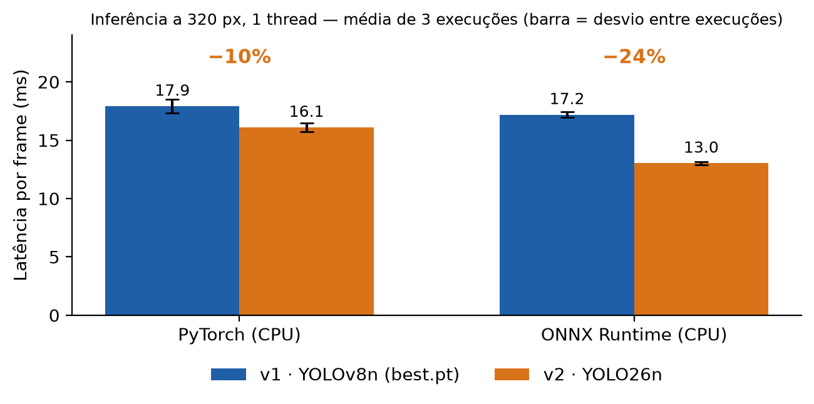
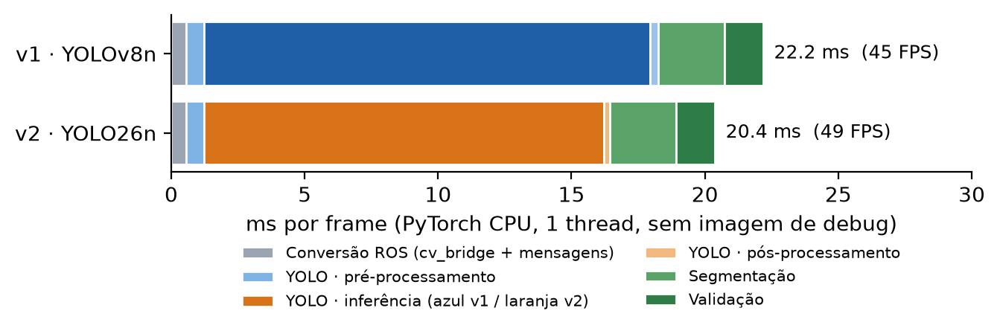
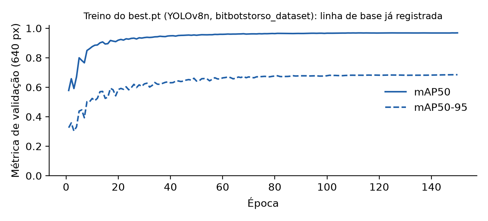

# Benchmarks: YOLOv8n × YOLO26n

Metodologia, hardware, configurações e limitações das medições de **velocidade e custo computacional**
citadas no [README](../README.md). **Nada aqui mede acurácia de detecção**: essa comparação ainda
precisa ser feita (veja [Acurácia: o que falta](#acurácia-o-que-falta-medir)).

## Resumo

| Métrica | YOLOv8n (v1) | YOLO26n (v2) | Diferença |
|---|---|---|---|
| Parâmetros (modelo fundido) | 3,01 M | 2,38 M | −21% |
| GFLOPs a 320 px | 2,02 | 1,31 | −35% |
| Latência de inferência, PyTorch (CPU) | 17,9 ms | 16,1 ms | −10% |
| Latência de inferência, ONNX Runtime (CPU) | 17,2 ms | 13,0 ms | −24% |
| Tempo total do pipeline por frame | 22,2 ms | 20,4 ms | −8% |
| Taxa aproximada do pipeline completo | 45 FPS | 49 FPS |  |

"Pipeline completo" = conversão da imagem + YOLO + segmentação + validação + montagem das mensagens, **sem** a
imagem de debug, em PyTorch, 1 thread.

## Ambiente de medição

| Item | Valor |
|---|---|
| CPU | Intel Xeon @ 2,1 GHz, **1 vCPU** (container Linux) |
| Memória | 4,2 GB |
| Python | 3.12 |
| PyTorch | 2.14.1 (CPU, conda-forge); `torch.set_num_threads(1)` |
| Ultralytics | 8.4.184 |
| ONNX Runtime | 1.31.0 (CPUExecutionProvider) |
| OpenCV | 5.0.0 |
| GPU | nenhuma |

> Os milissegundos absolutos **não se transferem** para outro computador nem para o robô. Vale a
> comparação **relativa** entre os modelos, medidos nas mesmas condições.

## Modelos

| Rótulo | O que é | Pesos |
|---|---|---|
| v1 · YOLOv8n | `best.pt`: YOLOv8n, 7 classes, treinado 150 épocas (veja [Acurácia](#acurácia-o-que-falta-medir)) | treinados |
| v2 · YOLO26n | arquitetura oficial `yolo26n.yaml` com cabeça de 7 classes | **não treinados** (a latência não depende dos pesos) |
| controle · YOLOv8n arq. | arquitetura `yolov8n.yaml` com 7 classes | não treinados |
| referência · YOLOv8n/YOLO26n COCO | `yolov8n.pt` e `yolo26n.pt` oficiais (80 classes) | oficiais |

O **controle** valida o método: `best.pt` (treinado) e a arquitetura YOLOv8n sem treino deram latências
equivalentes (17,9 ± 0,6 ms contra 17,4 ± 0,7 ms em PyTorch), o que sustenta medir a velocidade do YOLO26n com a
arquitetura sem treino.

## Configuração

- **Inferência** (a mesma de `running_inference.py`): `imgsz=320`, confiança 0,45, `max_det=10`, `iou=0,5`
  (só tem efeito no YOLOv8, que usa NMS; o YOLO26 é NMS-free).
- **Frames**: 8 cenas sintéticas 1080×720 (céu, campo, linhas, bola e robô), geradas por `synthetic_frames()`
  em `compare_models.py`. Não são imagens reais de Webots nem do robô.
- **Protocolo**: 400 frames por modelo em 8 rodadas **alternadas** (v1, v2, controle, v1, v2…) para diluir a
  deriva da máquina; 30 frames de aquecimento; o tempo total inclui `predict` e a leitura das caixas.
- **Repetição**: o experimento completo foi repetido **3 vezes independentes**; os números principais são a
  média das 3 e o ± é o desvio entre elas.
- **Parâmetros e GFLOPs** são do modelo **fundido** (BatchNorm incorporada), que é o que roda em inferência.
  Para os modelos COCO coincidem com os publicados pela Ultralytics.

## Resultados

### Tamanho e custo computacional

| Modelo | Parâmetros (M) | GFLOPs a 320 px | GFLOPs a 640 px | Arquivo (MB) |
|---|---|---|---|---|
| **v1** · YOLOv8n best.pt | 3,01 | 2,02 | 8,09 | 6,3 |
| **v2** · YOLO26n 7 classes | 2,38 | 1,31 | 5,32 | 5,4 |
| YOLOv8n COCO (referência) | 3,15 | 2,19 | 8,74 | 6,5 |
| YOLO26n COCO (referência) | 2,41 | 1,35 | 5,48 | 5,5 |

### Latência de inferência (320 px, 1 thread)

| Modelo | PyTorch, exec. 1 / 2 / 3 (ms) | PyTorch, média (ms) | ONNX, exec. 1 / 2 / 3 (ms) | ONNX, média (ms) |
|---|---|---|---|---|
| **v1** · YOLOv8n | 17,1 / 18,0 / 18,6 | 17,9 ± 0,6 | 16,9 / 17,2 / 17,5 | 17,2 ± 0,2 |
| **v2** · YOLO26n | 15,8 / 15,9 / 16,6 | 16,1 ± 0,4 | 12,8 / 13,2 / 13,1 | 13,0 ± 0,1 |
| **Redução v2 vs v1** | −8% / −12% / −11% | **−10%** | −24% / −24% / −25% | **−24%** |
| controle (YOLOv8n arq.) | 17,2 / 16,7 / 18,3 | 17,4 ± 0,7 | 16,3 / 17,4 / 17,1 | 16,9 ± 0,5 |



Por fase, em PyTorch (média das 3 execuções):

| Modelo | Pré-processamento (ms) | Inferência (ms) | Pós-processamento (ms) | Total (ms) |
|---|---|---|---|---|
| **v1** · YOLOv8n | 0,65 | 16,71 | 0,31 | 17,91 |
| **v2** · YOLO26n | 0,65 | 14,98 | 0,23 | 16,11 |

### Orçamento do frame completo



| Etapa | v1 (ms) | v2 (ms) |
|---|---|---|
| Conversão ROS (cv_bridge + mensagens) | 0,57 | 0,57 |
| YOLO · pré-processamento | 0,65 | 0,65 |
| YOLO · inferência | 16,71 | 14,98 |
| YOLO · pós-processamento | 0,31 | 0,23 |
| Segmentação | 2,49 | 2,49 |
| Validação | 1,46 | 1,46 |
| **Total do frame** | **22,2 (45 FPS)** | **20,4 (49 FPS)** |
| Imagem de debug (opcional) | 7,4 | 7,4 |

A imagem de debug só é desenhada quando há assinante em `processed_image_topic` ou a janela está ligada. A
conversão ROS soma `cv_bridge` (≈0,4 ms) e a montagem das mensagens (<0,2 ms).

### Resolução de treino (640 px)

O modelo foi treinado a 640 px, mas o nó roda a 320 px. Uma execução a 640 px (200 frames por modelo,
4 rodadas):

| Modelo (640 px, PyTorch) | Latência (ms) | p95 (ms) | FPS |
|---|---|---|---|
| **v1** · YOLOv8n | 61,0 ± 5,2 | 70,3 | 16,4 |
| **v2** · YOLO26n | 52,5 ± 3,2 | 57,4 | 19,0 |
| **Redução v2 vs v1** | **−14%** |  |  |

(uma única execução; o ± é o desvio entre os frames, não entre execuções.)

## Como ler os resultados

- **A velocidade favorece o YOLO26n de forma consistente** nas 3 execuções e a 640 px.
- **A latência não cai na proporção dos FLOPs**: os GFLOPs caem 35%, mas o tempo em PyTorch cai
  10%. Nesse tamanho de rede e com 1 thread, parte do tempo não é aritmética. O ONNX Runtime
  aproveita melhor a simplificação do grafo exportado (−24%).
- **O NMS-free quase não aparece**: o pós-processamento custa 0,2–0,3 ms nos dois, porque com confiança 0,45 e
  até 10 detecções há poucos candidatos.
- **O ganho no sistema é menor que no modelo**, porque o YOLO é cerca de 80% do tempo do frame:
  o frame completo cai 8% (22,2 → 20,4 ms).
- **Comparação com o fabricante.** A documentação da Ultralytics reporta, a 640 px em CPU com ONNX, 38,9 ms para o
  YOLO26n contra 56,1 ms para o YOLO11n, e mAP em COCO de 40,9 contra 39,5. São números em COCO, em outro hardware
  e contra o YOLO11n (o YOLOv8n não consta dessa tabela). As medições deste repositório são mais modestas, mas
  apontam na mesma direção.

## Limitações experimentais

1. **1 vCPU e 4,2 GB de RAM**: sem paralelismo; o comportamento em CPUs multinúcleo, GPU ou no computador do robô
   pode ser diferente.
2. **Frames sintéticos**: o custo de pós-processamento (NMS no YOLOv8) depende de quantos candidatos o modelo gera,
   e imagens reais podem gerar mais.
3. **Pesos do YOLO26n não treinados**: a latência independe dos pesos (validado pelo controle), mas o número de
   detecções acima do limiar, e portanto o pós-processamento, pode diferir com pesos treinados.
4. **Só CPU**: ONNX Runtime foi medido em `CPUExecutionProvider`; TensorRT/OpenVINO/GPU não foram medidos.
5. **Variação entre execuções de cerca de 1 ms** (por isso são 3 execuções); diferenças menores que isso não são
   conclusivas.
6. **Sem Webots e sem robô**: nada foi medido dentro do simulador nem no hardware do robô; a latência de transporte
   do ROS 2 não está incluída.
7. **Sem acurácia** (próxima seção).

## Acurácia: o que falta medir

O `best.pt` guarda as métricas de validação do próprio treino (a 640 px): **precisão 0,944, recall 0,926,
mAP50 0,968 e mAP50-95 0,685**, em 150 épocas com `yolov8n.pt` como ponto de partida.



Não existe ainda um YOLO26n treinado para as 7 classes, então **a equivalência de acurácia entre YOLOv8n e
YOLO26n não foi estabelecida**. Para fechá-la:

```bash
export PYTHONPATH=$PWD/src

# 1) treina o YOLO26n com a MESMA receita do best.pt (lida do próprio checkpoint)
python -m Webots_YOLOv8.tools.train_yolo26n --baseline /caminho/best.pt \
    --data /caminho/dataset/data.yaml --device 0

# 2) compara acurácia no conjunto de teste, NA RESOLUÇÃO DO NÓ (320 px), e velocidade
python -m Webots_YOLOv8.tools.compare_models \
    --models /caminho/best.pt runs/treinamento_bitbotstorso_dataset_yolo26n/weights/best.pt \
    --labels "v1 YOLOv8n" "v2 YOLO26n" \
    --data /caminho/dataset/data.yaml --split test --imgsz 320 --onnx --pipeline
```

Critérios sugeridos para decidir: mAP50-95 a 320 px do v2 não inferior ao do v1 além de uma tolerância definida
por você (sugestão: 1 ponto percentual); atenção ao recall da bola e do robô; avaliar a bola distante
separadamente; reconferir o limiar de confiança 0,45, cuja calibração pode diferir no YOLO26.

## Reprodução

```bash
export PYTHONPATH=$PWD/src
pip install ultralytics onnx onnxruntime

# velocidade, só com as arquiteturas (sem pesos treinados), 7 classes
python -m Webots_YOLOv8.tools.compare_models --models /caminho/best.pt yolo26n.yaml yolov8n.yaml \
    --labels "v1" "v2" "controle" --nc 7 --runs 400 --rounds 8 --warmup 30 --threads 1 \
    --onnx --pipeline --output-dir resultados
```

A ferramenta grava `resultados/results.json` (todos os números) e `resultados/results.md` (tabela). Para
**avaliar outra arquitetura**, acrescente o `.yaml` dela a `--models` (por exemplo, `yolo11n.yaml`; a
capacidade foi verificada, mas as latências dessa execução curta não são citadas aqui). Com `--images PASTA`
ela mede em imagens reais em vez das cenas sintéticas.
