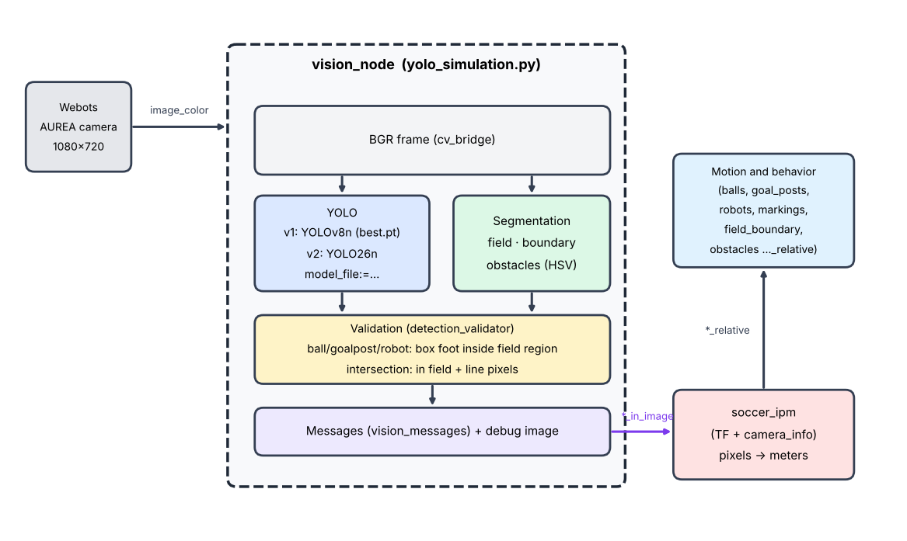

# Architecture

How the camera image becomes **validated** detections that `soccer_ipm` converts into meters.

## Two packages, one direction of dependency

| Package | Where | Role | Depends on ROS? |
|---|---|---|---|
| `pipeline` | `src/pipeline/` | Color-based segmentation **algorithm** (field, obstacles, line points) | **No.** Only numpy, OpenCV and pandas |
| `Webots_YOLOv8` | `src/Webots_YOLOv8/` | **Integration**: YOLO, validation, parameters, messages and the ROS 2 node | Only `yolo_simulation.py` and `vision_messages.py` |

The dependency **always** goes from `Webots_YOLOv8` to `pipeline`, never the other way around. This is what lets you
experiment with the segmentation on its own (`python -m pipeline photo.png`), without ROS and without a detector.
A test (`test/test_pipeline_independence.py`) blocks the imports of `rclpy`, `cv_bridge`, `ultralytics`, `torch` and
`Webots_YOLOv8` and requires `pipeline` to work that way; if someone imports any of them there, the test fails.

Modules of `Webots_YOLOv8`:

| File | Responsibility | Uses ROS |
|---|---|---|
| `detections.py` | Model classes, `Detection`, `Verdict`, rejection reasons, class-name check | no |
| `detection_validator.py` | Field region and validation rules | no |
| `vision_parameters.py` | Parameter declaration, reading and validation | typing only |
| `vision_debug.py` | Debug image (field, accepted and rejected boxes) | no |
| `vision_messages.py` | Detections and segmentation → `soccer_vision_2d_msgs` messages | yes |
| `running_inference.py` | Loads the model and runs inference | only when resolving the weights path |
| `yolo_simulation.py` | Node: only **orchestrates** capture → YOLO → segmentation → validation → publishing | yes |
| `tools/` | `compare_models.py` (benchmark and accuracy) and `train_yolo26n.py` (training recipe) | no |

## What happens in each frame

1. The camera publishes `/AUREA/camera_optical_frame/image_color`; the callback converts it to BGR (`cv_bridge`).
2. **YOLO.** `running_inference.detect_model` runs the model at 320 px (confidence 0.45, up to 10 detections) and
   returns classes, scores and boxes `[center_x, center_y, width, height]` in pixels of the original image;
   `detections_from_yolo` converts them into `Detection` objects.
3. **Segmentation.** `VisionPipeline.run` downscales the frame to 540 px wide, finds the field boundary, the
   obstacles and the line points, and returns everything in original-image coordinates.
4. **Validation.** `DetectionValidator.validate` returns one `Verdict` per detection: accepted, or rejected with the reason.
5. **Publishing.** Only accepted detections become messages. The ball, goalpost, robot and intersection arrays are
   published every frame, **even when empty**, so the behavior knows "there is no ball" instead of receiving no
   information. The field boundary and the obstacles are also published.
6. **Projection.** `soccer_ipm` uses TF and `camera_info` to project the pixels onto the field plane and publishes
   the positions in meters (`*_relative`).
7. **Debug.** If there is a subscriber on `processed_image_topic` or the window is enabled, the debug image is drawn;
   otherwise this cost (≈7 ms) is not paid.

## The segmentation (`src/pipeline/`)

It implements the *pipe-and-filter* pattern from the Hamburg Bit-Bots paper: each module is an independent filter
that receives an image and produces a structured output.

| Module | What it does |
|---|---|
| `color_common.py` | HSV color spaces (`ColorSpaceHSV`; the hue can be **circular**, for red) and the `ColorDetector`. Derives the field range from a calibration CSV (`color_spaces_from_calibration`) |
| `field_boundary_detector.py` | **Column** scan (1 in every `column_step`, default 4): top to bottom until green is found; with `head_tilted_up`, bottom to top with morphological closing. It then computes the **convex hull**, which removes the "teeth" caused by obstacles |
| `obstacle_detector.py` | The region between the convex hull and the real boundary is an obstacle candidate if its area exceeds `min_obstacle_area` (default 150 px²). It is classified by dominant color: red, blue or white (goalpost) |
| `line_detector.py` | Returns **points** (not lines) on the markings: it samples pixels below the top of the boundary, with higher density near the robot and where there was a detection in the previous frame |
| `main_pipeline.py` | `VisionPipeline` orchestrates the filters; `PipelineConfig`/`PipelineResult`; downscales the image to `process_width` (default 540) and returns the results at the original resolution; YOLO fusion and debug helpers |

With no field in the image (fewer than 3 boundary points), the pipeline returns `field_detected=False` and nothing
else: this avoids treating the white of walls as field lines. The cost is ≈2.5 ms per frame (1080×720, 1 vCPU). The
ROS node turns the line points off (`n_line_samples=0`: they are neither computed nor published); the validation of
intersections uses the markings mask directly.

**Calibration.** The color ranges must be calibrated for your camera and lighting. In the node, the field range comes
from `recursos/green_pixels.csv` (see `recursos/README.md`) and can be overridden with `hsv.*_min/max`.

## Validation: a detection only counts inside the segmented area

The **field region** is the convex hull of the detected boundary. Rules (`detection_validator.py`):

| YOLO class | Rule | Rejection reason |
|---|---|---|
| ball, goalpost, robot | The **footpoint** (center of the box base) must be inside the field region, with a tolerance of `footpoint_margin_px` (12) | `outside_field` |
| L, T, X intersection | The center must be inside the field region **and** at least `min_marking_ratio` (4%) of the box must contain line pixels | `outside_field`, `no_marking` |
| crossbar (`crossbar`) | Never published (there is no message) | `ignored_class` |
| any | If the segmentation found no field, nothing is validated | `no_field` |

The footpoint is the same criterion `soccer_ipm` uses (center + half the box height), so what gets validated is
exactly the point that will be projected onto the ground. The field mask lives at the processing resolution
(540 px); `FieldRegion` converts the points to that scale instead of resizing the mask every frame, and queries a
window of `±margin` pixels. Points outside the image are clamped to the borders.

`validation.enabled:=false` publishes everything YOLO detects (except the crossbar), as if there were no validation.

## Messages and topics

| Topic | Type | Content |
|---|---|---|
| `balls_in_image` | `soccer_vision_2d_msgs/BallArray` | validated balls (center and box in px) |
| `goal_posts_in_image` | `GoalpostArray` | validated goalposts |
| `robots_in_image` | `RobotArray` | validated robots |
| `markings_in_image` | `MarkingArray` | validated intersections, with number of rays (L=2, T=3, X=4) |
| `field_boundary_in_image` | `FieldBoundary` | field boundary; **never published empty** |
| `obstacles_in_image` | `ObstacleArray` | what the segmentation saw and YOLO did not explain as ball/goalpost/robot |
| `processed_image_topic` | `sensor_msgs/Image` | debug image (only drawn with a subscriber or window) |

`soccer_ipm` discards objects whose footpoint falls in the bottom 20% of the image
(`footpoint_out_of_image_threshold` = 0.8, its default), since they are partially out of frame.

## Parameters

| Parameter | Default | Effect |
|---|---|---|
| `model_file` | `best.pt` | Weights: a name in `modelo/` or an **absolute path**. **Startup only** |
| `strict_class_check` | `true` | At startup, rejects a model whose classes are not the node's. **Startup only** |
| `show_window` | `true` | OpenCV window (launch argument; `false` to run without a display) |
| `publish_segmentation` | `true` | Publishes boundary and obstacles |
| `validation.enabled` | `true` | Turns validation on/off |
| `validation.footpoint_margin_px` | `12` | Footpoint tolerance |
| `validation.min_marking_ratio` | `0.04` | Minimum fraction of line pixels in an intersection box |
| `pipeline.process_width` | `540` | Segmentation processing width (0 = no downscaling) |
| `pipeline.column_step` | `4` | 1 column in every N in the boundary scan |
| `pipeline.min_obstacle_area` | `150` | Minimum obstacle area (px²) |
| `pipeline.head_tilted_up` | `false` | Bottom-to-top scan |
| `hsv.{field,white,red,blue}_{min,max}` | derived | HSV ranges (**integers**); red uses a circular hue |

Everything except `model_file` and `strict_class_check` can be changed at runtime with `ros2 param set`. An invalid
change (for example, a hue outside 0–179) is **rejected as a whole** and the node keeps the previous values. The
defaults are in [`config/vision_params.yaml`](../config/vision_params.yaml).

## Detector class scheme

The node interprets the model IDs as follows (`detections.YoloClass`):

| ID | 0 | 1 | 2 | 3 | 4 | 5 | 6 |
|---|---|---|---|---|---|---|---|
| Class | `ball` | `goalpost` | `robot` | `L-Intersection` | `T-Intersection` | `X-Intersection` | `crossbar` |

A model with a **different scheme** (for example, with left/right goal or a center circle) would have its IDs read
with the wrong meaning. That is why, at startup, the node compares `model.names` against this map and **rejects the
model**, listing the mismatches. `strict_class_check:=false` downgrades this to a warning. To support another
scheme, change `YoloClass`, `EXPECTED_CLASS_NAMES`, the validator rules and the message builder.

## Robustness decisions

- **An empty boundary is never published**: `soccer_ipm` fails with 0 points.
- **Every number goes through `float()` before entering a message**: `rclpy` rejects `int` in a `double` field
  (`AssertionError`); test stubs do not catch this, which is why the tests use real ROS messages.
- **One bad frame does not bring the node down**: the callback catches the exception, logs the traceback (at most
  once every 5 s) and carries on; publishing happens **before** the debug drawing.
- **`soccer_ipm` discards the message, instead of crashing, if `camera_info` has not arrived yet**: this requires the
  patch in [`docs/patches/`](patches/soccer_ipm_camera_info.patch) (see [development.md](development.md)).
- **On-demand debug**: `detect_model(..., draw=False)` skips Ultralytics' `plot()`.
- **Invalid parameters are rejected atomically.**

## Known limitations

- **The camera topic is fixed** (`CAMERA_TOPIC` in `yolo_simulation.py`: `/AUREA/camera_optical_frame/image_color`).
  For another camera, use a remap: `ros2 run Webots_YOLOv8 finder --ros-args -r /AUREA/camera_optical_frame/image_color:=/my/camera`.
  In `launch/vision.launch.py`, the `soccer_ipm` remaps also point to the AUREA topics.
- **Single output format**: the messages are `soccer_vision_2d_msgs`. If your behavior consumes another format,
  an adapter is needed (not included).
- **One robot, one camera**: there is no support for multiple cameras or lens distortion (`use_distortion` is `false`).
- **Example HSV ranges**: `DEFAULT_COLOR_SPACES` (used by `python -m pipeline` without `--hsv-csv`) are only a
  starting point and must be calibrated.
