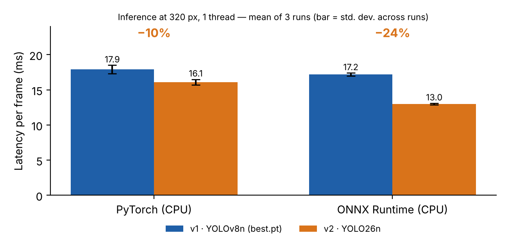
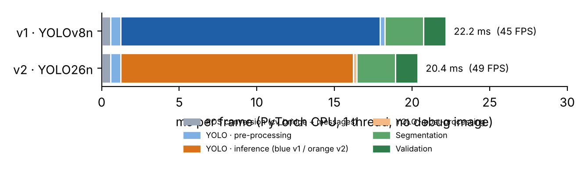
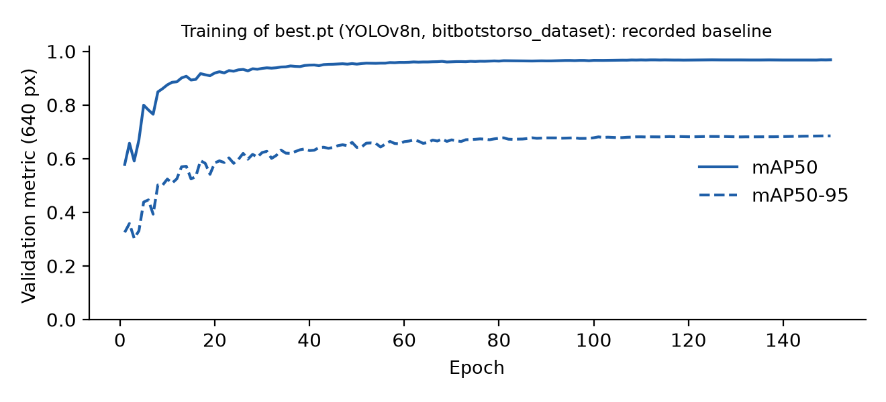

# Benchmarks: YOLOv8n × YOLO26n

Methodology, hardware, configurations and limitations of the **speed and computational cost** measurements
cited in the [README](../README.md). **Nothing here measures detection accuracy**: that comparison still has to be
done (see [Accuracy: what remains to be measured](#accuracy-what-remains-to-be-measured)).

## Summary

| Metric | YOLOv8n (v1) | YOLO26n (v2) | Difference |
|---|---|---|---|
| Parameters (fused model) | 3.01 M | 2.38 M | −21% |
| GFLOPs at 320 px | 2.02 | 1.31 | −35% |
| Inference latency, PyTorch (CPU) | 17.9 ms | 16.1 ms | −10% |
| Inference latency, ONNX Runtime (CPU) | 17.2 ms | 13.0 ms | −24% |
| Total pipeline time per frame | 22.2 ms | 20.4 ms | −8% |
| Approximate full-pipeline rate | 45 FPS | 49 FPS |  |

"Full pipeline" = image conversion + YOLO + segmentation + validation + message assembly, **without** the debug
image, in PyTorch, 1 thread.

## Measurement environment

| Item | Value |
|---|---|
| CPU | Intel Xeon @ 2.1 GHz, **1 vCPU** (Linux container) |
| Memory | 4.2 GB |
| Python | 3.12 |
| PyTorch | 2.14.1 (CPU, conda-forge); `torch.set_num_threads(1)` |
| Ultralytics | 8.4.184 |
| ONNX Runtime | 1.31.0 (CPUExecutionProvider) |
| OpenCV | 5.0.0 |
| GPU | none |

> Absolute milliseconds **do not transfer** to another computer or to the robot. What holds is the **relative**
> comparison between the models, measured under the same conditions.

## Models

| Label | What it is | Weights |
|---|---|---|
| v1 · YOLOv8n | `best.pt`: YOLOv8n, 7 classes, trained for 150 epochs (see [Accuracy](#accuracy-what-remains-to-be-measured)) | trained |
| v2 · YOLO26n | official `yolo26n.yaml` architecture with a 7-class head | **untrained** (latency does not depend on the weights) |
| control · YOLOv8n arch. | `yolov8n.yaml` architecture with 7 classes | untrained |
| reference · YOLOv8n/YOLO26n COCO | official `yolov8n.pt` and `yolo26n.pt` (80 classes) | official |

The **control** validates the method: `best.pt` (trained) and the untrained YOLOv8n architecture gave equivalent
latencies (17.9 ± 0.6 ms versus 17.4 ± 0.7 ms in PyTorch), which supports measuring YOLO26n speed with the
untrained architecture.

## Configuration

- **Inference** (the same as `running_inference.py`): `imgsz=320`, confidence 0.45, `max_det=10`, `iou=0.5`
  (only effective for YOLOv8, which uses NMS; YOLO26 is NMS-free).
- **Frames**: 8 synthetic 1080×720 scenes (sky, field, lines, ball and robot), generated by `synthetic_frames()`
  in `compare_models.py`. They are not real images from Webots or from the robot.
- **Protocol**: 400 frames per model in 8 **alternating** rounds (v1, v2, control, v1, v2…) to dilute machine
  drift; 30 warm-up frames; total time includes `predict` and reading the boxes.
- **Repetition**: the full experiment was repeated **3 independent times**; the headline numbers are the mean of
  the 3 and the ± is the standard deviation between them.
- **Parameters and GFLOPs** are for the **fused** model (BatchNorm folded in), which is what runs at inference.
  For the COCO models they match the figures published by Ultralytics.

## Results

### Size and computational cost

| Model | Parameters (M) | GFLOPs at 320 px | GFLOPs at 640 px | File (MB) |
|---|---|---|---|---|
| **v1** · YOLOv8n best.pt | 3.01 | 2.02 | 8.09 | 6.3 |
| **v2** · YOLO26n 7 classes | 2.38 | 1.31 | 5.32 | 5.4 |
| YOLOv8n COCO (reference) | 3.15 | 2.19 | 8.74 | 6.5 |
| YOLO26n COCO (reference) | 2.41 | 1.35 | 5.48 | 5.5 |

### Inference latency (320 px, 1 thread)

| Model | PyTorch, run 1 / 2 / 3 (ms) | PyTorch, mean (ms) | ONNX, run 1 / 2 / 3 (ms) | ONNX, mean (ms) |
|---|---|---|---|---|
| **v1** · YOLOv8n | 17.1 / 18.0 / 18.6 | 17.9 ± 0.6 | 16.9 / 17.2 / 17.5 | 17.2 ± 0.2 |
| **v2** · YOLO26n | 15.8 / 15.9 / 16.6 | 16.1 ± 0.4 | 12.8 / 13.2 / 13.1 | 13.0 ± 0.1 |
| **Reduction v2 vs v1** | −8% / −12% / −11% | **−10%** | −24% / −24% / −25% | **−24%** |
| control (YOLOv8n arch.) | 17.2 / 16.7 / 18.3 | 17.4 ± 0.7 | 16.3 / 17.4 / 17.1 | 16.9 ± 0.5 |



By phase, in PyTorch (mean of the 3 runs):

| Model | Pre-processing (ms) | Inference (ms) | Post-processing (ms) | Total (ms) |
|---|---|---|---|---|
| **v1** · YOLOv8n | 0.65 | 16.71 | 0.31 | 17.91 |
| **v2** · YOLO26n | 0.65 | 14.98 | 0.23 | 16.11 |

### Full-frame budget



| Stage | v1 (ms) | v2 (ms) |
|---|---|---|
| ROS conversion (cv_bridge + messages) | 0.57 | 0.57 |
| YOLO · pre-processing | 0.65 | 0.65 |
| YOLO · inference | 16.71 | 14.98 |
| YOLO · post-processing | 0.31 | 0.23 |
| Segmentation | 2.49 | 2.49 |
| Validation | 1.46 | 1.46 |
| **Frame total** | **22.2 (45 FPS)** | **20.4 (49 FPS)** |
| Debug image (optional) | 7.4 | 7.4 |

The debug image is only drawn when there is a subscriber on `processed_image_topic` or the window is enabled. The
ROS conversion adds up `cv_bridge` (≈0.4 ms) and message assembly (<0.2 ms).

### Training resolution (640 px)

The model was trained at 640 px, but the node runs at 320 px. A run at 640 px (200 frames per model,
4 rounds):

| Model (640 px, PyTorch) | Latency (ms) | p95 (ms) | FPS |
|---|---|---|---|
| **v1** · YOLOv8n | 61.0 ± 5.2 | 70.3 | 16.4 |
| **v2** · YOLO26n | 52.5 ± 3.2 | 57.4 | 19.0 |
| **Reduction v2 vs v1** | **−14%** |  |  |

(a single run; the ± is the deviation between frames, not between runs.)

## How to read the results

- **Speed consistently favors YOLO26n** across the 3 runs and at 640 px.
- **Latency does not drop in proportion to FLOPs**: GFLOPs fall 35%, but PyTorch time falls 10%. At this network
  size and with 1 thread, part of the time is not arithmetic. ONNX Runtime makes better use of the simplified
  exported graph (−24%).
- **NMS-free barely shows**: post-processing costs 0.2–0.3 ms in both, because with confidence 0.45 and at most
  10 detections there are few candidates.
- **The gain at system level is smaller than at model level**, because YOLO is about 80% of the frame time:
  the full frame drops 8% (22.2 → 20.4 ms).
- **Comparison with the vendor.** Ultralytics' documentation reports, at 640 px on CPU with ONNX, 38.9 ms for
  YOLO26n against 56.1 ms for YOLO11n, and COCO mAP of 40.9 against 39.5. Those are COCO numbers, on other
  hardware and against YOLO11n (YOLOv8n is not in that table). The measurements in this repository are more modest,
  but point in the same direction.

## Experimental limitations

1. **1 vCPU and 4.2 GB of RAM**: no parallelism; behavior on multi-core CPUs, GPUs or on the robot's computer may
   differ.
2. **Synthetic frames**: the post-processing cost (NMS in YOLOv8) depends on how many candidates the model
   generates, and real images may generate more.
3. **Untrained YOLO26n weights**: latency does not depend on the weights (validated by the control), but the number
   of detections above the threshold, and therefore post-processing, may differ with trained weights.
4. **CPU only**: ONNX Runtime was measured on `CPUExecutionProvider`; TensorRT/OpenVINO/GPU were not measured.
5. **Run-to-run variation of about 1 ms** (hence 3 runs); differences smaller than that are not conclusive.
6. **No Webots and no robot**: nothing was measured inside the simulator or on the robot hardware; ROS 2
   transport latency is not included.
7. **No accuracy** (next section).

## Accuracy: what remains to be measured

`best.pt` stores the validation metrics from its own training (at 640 px): **precision 0.944, recall 0.926,
mAP50 0.968 and mAP50-95 0.685**, over 150 epochs starting from `yolov8n.pt`.



There is not yet a YOLO26n trained for the 7 classes, so **accuracy equivalence between YOLOv8n and YOLO26n has
not been established**. To close it:

```bash
export PYTHONPATH=$PWD/src

# 1) train YOLO26n with the SAME recipe as best.pt (read from the checkpoint itself)
python -m Webots_YOLOv8.tools.train_yolo26n --baseline /path/to/best.pt \
    --data /path/to/dataset/data.yaml --device 0

# 2) compare accuracy on the test set, AT THE NODE'S RESOLUTION (320 px), and speed
python -m Webots_YOLOv8.tools.compare_models \
    --models /path/to/best.pt runs/treinamento_bitbotstorso_dataset_yolo26n/weights/best.pt \
    --labels "v1 YOLOv8n" "v2 YOLO26n" \
    --data /path/to/dataset/data.yaml --split test --imgsz 320 --onnx --pipeline
```

Suggested decision criteria: v2's mAP50-95 at 320 px not inferior to v1's beyond a tolerance you define
(suggestion: 1 percentage point); pay attention to ball and robot recall; evaluate the distant ball separately;
re-check the 0.45 confidence threshold, whose calibration may differ in YOLO26.

## Reproduction

```bash
export PYTHONPATH=$PWD/src
pip install ultralytics onnx onnxruntime

# speed, architectures only (no trained weights), 7 classes
python -m Webots_YOLOv8.tools.compare_models --models /path/to/best.pt yolo26n.yaml yolov8n.yaml \
    --labels "v1" "v2" "control" --nc 7 --runs 400 --rounds 8 --warmup 30 --threads 1 \
    --onnx --pipeline --output-dir resultados
```

The tool writes `resultados/results.json` (all numbers) and `resultados/results.md` (table). To **evaluate another
architecture**, add its `.yaml` to `--models` (for example, `yolo11n.yaml`; the capability was verified, but the
latencies of that short run are not cited here). With `--images FOLDER` it measures on real images instead of the
synthetic scenes.
